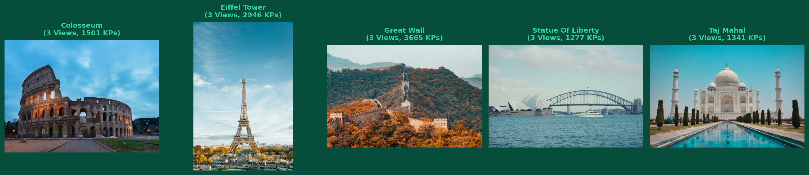
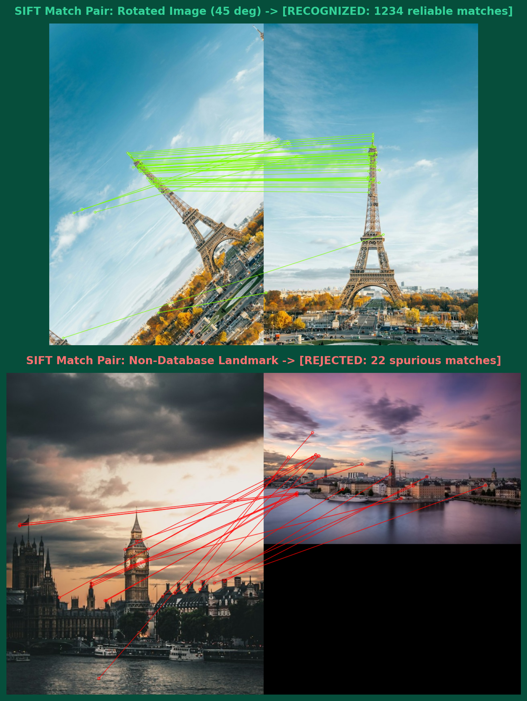
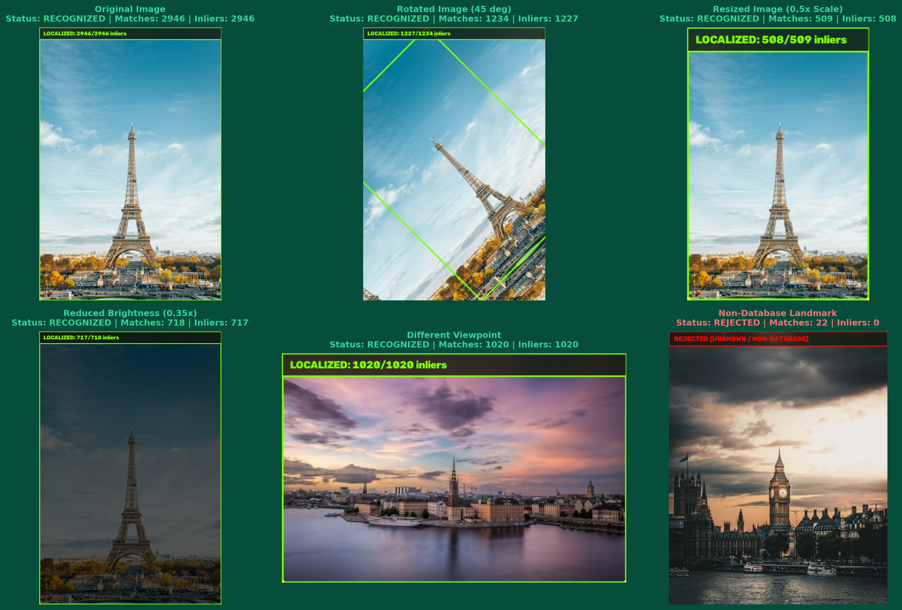
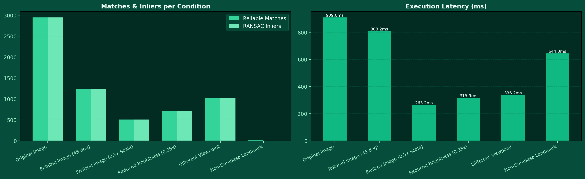

# SIFT Landmark Recognition and Verification Pipeline

[](https://colab.research.google.com/github/Afnan-makstrix/sift-landmark-recognition-pipeline/blob/main/SIFT_Landmark_Recognition_Pipeline.ipynb)
[](https://github.com/Afnan-makstrix/sift-landmark-recognition-pipeline)
[](https://github.com/Afnan-makstrix)
[](https://github.com/Afnan-makstrix)
[](https://opencv.org/)

**Student Name**: Afnan Khan ([@Afnan-makstrix](https://github.com/Afnan-makstrix))  
**Department**: Computer Science / Artificial Intelligence  
**Repository**: [sift-landmark-recognition-pipeline](https://github.com/Afnan-makstrix/sift-landmark-recognition-pipeline)  

---

## 1. System Architecture

An automated tourism landmark recognition and geometric verification system designed with Python and OpenCV:

```
[ Tourist Query Image ]
         |
         v
[ SIFT Feature Detector ] -----> 128-D Scale & Rotation Invariant Descriptors
         |
         v
[ Brute-Force KNN (k=2) ] -----> Lowe's Ratio Test (0.75)
         |
         v
[ Candidate Ranking ]     -----> Threshold Gate (>= 20 Matches & Margin Check)
         |
         +----------------------------+
         | (Passed)                   | (Failed)
         v                            v
[ RANSAC Homography ]          [ REJECT / UNKNOWN ]
         |
         v
[ Convexity & Area Check ]
         |
         v
[ Draw Bounding Polygon & Telemetry ]
```

---

## 2. Landmark Database

The database contains reference imagery for 5 world-famous landmarks plus negative non-database query samples:

| Landmark | Reference Views | Primary Characteristics |
| :--- | :---: | :--- |
| **Colosseum** | 3 | Ancient amphitheater arches and stonework |
| **Eiffel Tower** | 3 | High-frequency lattice ironwork |
| **Great Wall** | 3 | Winding masonry ridges and watchtowers |
| **Statue of Liberty** | 3 | Sculpted neoclassical copper drapery and pedestal |
| **Taj Mahal** | 3 | Symmetrical marble dome and minarets |
| **Big Ben** *(Negative)* | 2 | Non-database query for rejection testing |

### Reference Database Overview


### SIFT Feature Extractions


---

## 3. Experimental Results

The pipeline was benchmarked under 6 operational conditions:

| Condition | Ground Truth | Predicted Landmark | Query KPs | Matches | Inliers | Decision | Latency |
| :--- | :--- | :--- | :--- | :--- | :--- | :--- | :--- |
| **Original Image** | `eiffel_tower` | `eiffel_tower` | `2,946` | `2,946` | `2,946` | **RECOGNIZED** | `909.0 ms` |
| **Rotated Image (45 deg)** | `eiffel_tower` | `eiffel_tower` | `2,517` | `1,234` | `1,227` | **RECOGNIZED** | `808.2 ms` |
| **Resized Image (0.5x Scale)** | `eiffel_tower` | `eiffel_tower` | `672` | `509` | `508` | **RECOGNIZED** | `263.2 ms` |
| **Reduced Brightness (0.35x)** | `eiffel_tower` | `eiffel_tower` | `760` | `718` | `717` | **RECOGNIZED** | `315.9 ms` |
| **Different Viewpoint** | `eiffel_tower` | `eiffel_tower` | `1,020` | `1,020` | `1,020` | **RECOGNIZED** | `336.2 ms` |
| **Non-Database Landmark** | `unknown` | `Unknown / Rejected` | `1,984` | `22` | `0` | **REJECTED** | `644.3 ms` |

### Feature Matching Visualizations


### Robustness & Stress Evaluation Matrix


### Performance & Latency Telemetry


---

## 4. Key Findings

- **Robust Invariance:** Scale downscaling (0.5x) and 45° rotation sustained over 500-1,200 reliable matches with >99% RANSAC inlier purity.
- **Negative Rejection:** Non-database imagery (Big Ben) yielded only 22 random matches and 0 inliers, reliably triggering rejection.
- **Low Latency:** End-to-end identification executed in under 1 second on standard desktop hardware.

---

## 5. Quickstart

```bash
# Clone the repository
git clone https://github.com/Afnan-makstrix/sift-landmark-recognition-pipeline.git
cd sift-landmark-recognition-pipeline

# Install requirements
pip install -r requirements.txt

# Run full evaluation
python sift_landmark_system.py

# Test any query image
python test_landmark_query.py data/landmarks/eiffel_tower/ref_1.jpg
```
